# Section 3 — This is the current process

**Guiding question:** How is a video produced today?

**What this section must accomplish:** show the twelve-step as-is map, walk **one order** through it end-to-end, and separate **active working time from waiting time** — this separation is the analytical foundation for everything that follows (Little's Law, TOC, the iteration design).

**Source of process information (state this on the slide):** process flowchart confirmed with HiLegal in **September 2026 [C]**; step durations a mix of company-reported figures [C] and our estimates [E].

---

## The as-is map (12 steps, confirmed with HiLegal)

```mermaid
flowchart LR
    R["1. Video request<br/>(email / chat)"] --> IQ["2. INTAKE QUEUE<br/>3–7 days · WAIT [C]<br/>≈2–5 requests parked in the inbox [E — Little's Law]"]
    IQ --> CL["3. CLARIFICATION<br/>producer ↔ lawyer emails/calls"]
    CL -->|"...still unclear"| IQ
    CL --> CB["4. CONTENT BRIEF<br/>producer writes manually · WORK"]
    CB --> SD["5. SCRIPT DRAFTING<br/>manual first draft · WORK"]
    SD --> AR["6. AI REFINEMENT<br/>ChatGPT, copy-paste · WORK"]
    AR --> AP{"7. APPROVAL<br/>lawyer reviews script"}
    AP -->|"rejected → redo"| SD
    AP -->|"approved"| FS["8. FINAL SCRIPT<br/>· WAIT"]
    FS --> VG["9. VIDEO GENERATION<br/>Seedance, manual prompting · WORK"]
    VG --> AG["10. AUDIO GENERATION<br/>separate TTS tool · WORK"]
    AG --> AVS["11. AUDIO-VISUAL SYNC<br/>MANUAL · 2–3 h [C] · WORK"]
    AVS --> FA{"12a. FINAL APPROVAL<br/>lawyer reviews video"}
    FA -->|"changes → redo"| FS
    FA -->|"approved"| PB["12b. SENT FOR DELIVERY<br/>+ manual platform adaptation ~2 h [C]"]
    PB --> DONE(("Video delivered"))
```

**Colour convention for the slide:** green = core transformational activities (Content Brief, Script Drafting, AI Refinement, Video Generation, Audio Generation, Audio-Visual Sync); white = coordination/decision stages (Intake Queue, Clarification, Approval, Final Script, Final Approval, Publishing) — this matches Figure 1 in the proposal exactly. The three rejection loops are the red arrows.

## One order moving through the process (the walkthrough story)

Follow a concrete case — **"Lawyer Chen, corporate-law intro video, 90 seconds, English + Mandarin subtitles"** — and give each step: who acts, active work, and elapsed time. Suggested trace (durations are [E] unless tagged [C]):

| #   | Step                             | Who               | Active work   | Elapsed (typical)  | Work or wait?             |
| --- | -------------------------------- | ----------------- | ------------- | ------------------ | ------------------------- |
| 1   | Video request                    | Lawyer            | 10 min        | —                  | Work (client)             |
| 2   | Intake queue                     | —                 | 0             | **3–7 days [C]**   | **Wait**                  |
| 3   | Clarification (×2–4 rounds)      | Producer + Lawyer | 60 min total  | 2–4 days           | Mostly wait               |
| 4   | Content brief                    | Producer          | 50 min        | same day           | Work                      |
| 5   | Script drafting                  | Producer          | 80 min        | day 1–2            | Work                      |
| 6   | AI refinement                    | Producer          | 40 min        | day 2              | Work                      |
| 7   | Script approval                  | Lawyer            | 10 min        | **1–3 days**       | **Wait** (loops → step 5) |
| 8   | Final script                     | —                 | 0             | —                  | Marker                    |
| 9   | Video generation                 | Producer          | 60 min        | 1 day              | Work                      |
| 10  | Audio generation                 | Producer          | 35 min        | same day           | Work                      |
| 11  | Audio-visual sync                | Producer          | **2–3 h [C]** | 1–2 days           | Work (bottleneck)         |
| 12a | Final approval                   | Lawyer            | 10 min        | **1–3 days**       | **Wait** (loops → step 8) |
| 12b | Publishing + platform adaptation | Producer          | ~2 h [C]      | 1 day              | Work                      |
| —   | **Total**                        |                   | **~10 h [C]** | **14–28 days [C]** |                           |

**The punchline of the section:** ~10 hours of work spread over 2–4 weeks. Work is ~6% of lead time; the other ~most elapsed time is waiting. **Process Cycle Efficiency ≈ 5–8% [E]** (600 min work ÷ 15 working days × 480 min).

## Work vs. waiting summary (put this table on a slide)

- **Total active work:** ~10 h/video [C] — of which the three largest manual blocks are sync 2–3 h, platform adaptation ~2 h, script drafting ~1.5 h (incl. redo rounds) [C for the first two, E for the third]
- **Total waiting:** 14–28 calendar days minus ~3–4 working days of work → dominated by intake queue (3–7 d [C]) and three approval gates that each loop [C]
- **Queue-gated process:** by Little's Law (Lead time = Work-in-progress × Cycle time), waiting — not work — drives lead time. Restate this sentence verbatim in Section 4.

## The intake queue, explained

The M/M/1 is an aggregate serial intake surrogate [E], not a literal description of two producers. A pooled inbox or non-preemption does not turn two workers into one server. The whole-process simulation instead has two FIFO task servers and releases them during client waits; its task durations are deterministic. The models are deliberately different simplifications and their waiting times must not be added as if they were independent components. Neither is independently validated against measured order histories.

At retained mu=23.5/month the consistent 30.4/22 conversion gives intake waits of approximately 2.28, 3.77 and 7.39 calendar days at assumed arrivals 15, 17.5 and 20/month. The reported 3–7-day and 15–20-output ranges do not establish paired endpoints. This is approximate calibration, not a fit to every endpoint. Implied dedication 23.5 x 10 / 352 = 66.76% is not an independent 65% estimate. The KPI scenario uses 60% of 160 h; it is a separate budget.

## Rework and the queue (full-process simulation → `../04 These are the wastes and root causes/Rework/`)

Rework is usually managed as extra *work*; operationally it is mostly extra *queue*. The `Rework/` folder (now in Section 4) simulates the **whole 12-step process** (two producers, three looping gates) and isolates the effect:

- Baseline (~90% of videos loop) vs. no rework: **+84 min of hands-on work but +10.8 days of lead time** — the queue cost of rework is ~29× its work cost [E]
- At 17.5 videos/month, work-in-process rises **6.2 → 12.7 → 17.2** videos from no-rework to baseline to heavy — and lead time = WIP ÷ throughput (Little's Law)
- Rework lowers the effective capacity ceiling: **~27.4 → ~23.6 → ~20.6 videos/month** (no rework → baseline → heavy, at realistic dedication); at 22/month with heavy rework the process is past capacity (overload: report backlog growth, not a stationary lead mean)
- Calibration checks: baseline 21.8 d lead (14–28 d [C]), 600 min work (~10 h [C]), 87% rework (~90% [E]), capacity ~23.6/month (demand 15–20 [C])

Files: `rework_simulation.py`, `rework-flow.md` (the flow + results guide), `rework-impact.svg`, `queue-sample-path.svg`, `rework-vs-demand.svg`, `gantt-rework.svg`.

## Where each number comes from (the audit trail)

| Figure | Status | Source |
|---|---|---|
| 12 steps + loops | [C] | Flowchart confirmed with HiLegal, Sept 2026 (proposal Fig. 1) |
| Lead time 2–4 weeks; ~10 h labour | [C] | Company-reported baseline (proposal Table 1) |
| Intake queue 3–7 days | [C] | Company-reported |
| Brief approval loop ≥4 iterations | [C] | Company-reported |
| Sync 2–3 h; platform adaptation ~2 h | [C] | Company-reported |
| Per-step minutes in the trace | [E] | Our decomposition; sums to the reported ~10 h — replace individual steps with time-log data if HiLegal shares any |
| 15–20 videos/month; ceiling 35–40 | [C] | Company-reported |
| Queue metrics (μ ≈ 23.5, ρ 0.64–0.85, Wq 2.3–7.5 d, Lq 2–5) | [E] | `../04 .../queue/queue_model.py` — calibrated on the [C] inputs above; validated by discrete-event simulation (±1%) |

## Files for this folder

The queue and rework evidence now lives in Section 4:
`../04 These are the wastes and root causes/queue/` (model, companion doc, three charts)
and `../04 These are the wastes and root causes/Rework/` (simulation, four charts, flow doc).
Section 4's START.md carries the narrative that uses them.

Still to produce in this folder:
- `process-map.png` — still to produce: export of the mermaid/slide version (green transformational, white coordination, red loops)
- `walkthrough.md` — still to produce: the one-order trace above as a 30-second narration
- `work-vs-wait.xlsx` (optional) — the trace table; you will reuse it in Sections 5 and 7

## Checklist

- [ ] One order followed end-to-end, named lawyer, concrete video
- [ ] Active vs waiting visually distinct (colour or icon)
- [ ] "Confirmed with HiLegal, September 2026" stated on the slide
- [ ] Do not label total-labour / elapsed-time ratios as value-added PCE without value-added observations
- [ ] Queueing slide shown: the utilization cliff (`../04 .../queue/queue-cliff.svg`) with the observed 3–7 d band and the calibration table
- [ ] One falsifiable prediction stated on the slide (inbox holds ≈ 2–5 pending requests — Little's Law)
- [ ] The ρ = 1 wall connected verbally to the company's own "ceiling 35–40" [C]
- [ ] Limitations owned: μ calibrated [E], intake-only scope

## Review correction 7 November 2026

The M/M/1 is an aggregate serial intake surrogate [E], not a literal description of two producers. A pooled inbox or non-preemption does not turn two workers into one server. The whole-process simulation instead has two FIFO task servers and releases them during client waits; its task durations are deterministic. The models are deliberately different simplifications and their waiting times must not be added as if they were independent components. Neither is independently validated against measured order histories.

At retained mu=23.5/month the consistent 30.4/22 conversion gives intake waits of approximately 2.28, 3.77 and 7.39 calendar days at assumed arrivals 15, 17.5 and 20/month. The reported 3–7-day and 15–20-output ranges do not establish paired endpoints. This is approximate calibration, not a fit to every endpoint. Implied dedication 23.5 x 10 / 352 = 66.76% is not an independent 65% estimate. The KPI scenario uses 60% of 160 h; it is a separate budget.

Current whole-process comparison and exact run settings are in `single source of truth/model-results.json` (repository root). Earlier single-seed traces are illustrations, not measured customer histories. Work of 10 h over 2–4 calendar weeks is 1.5–3.0% of wall-clock hours, or about 6–13% of an assumed 8-hour working-day clock. Neither ratio is value-added PCE.
