# Section 3 — This is the current process

**Guiding question:** How is a video produced today?

**What this section must accomplish:** show the twelve-step as-is map, walk **one order** through it end-to-end, and separate **active working time from waiting time** — this separation is the analytical foundation for everything that follows (Little's Law, TOC, the iteration design).

**Source of process information (state this on the slide):** process flowchart confirmed with HiLegal in **September 2026 [C]**; step durations a mix of company-reported figures [C] and our estimates [E].

---

## The as-is map (12 steps, confirmed with HiLegal)

```mermaid
flowchart LR
    R["1. Video request<br/>(email / chat)"] --> IQ["2. INTAKE QUEUE<br/>3–7 days · WAIT [C]<br/>≈2–5 requests parked in the inbox [E — Little's Law]"]
    IQ --> CL["3. CLARIFICATION<br/>producer ↔ lawyer emails/calls"]
    CL -->|"...still unclear"| IQ
    CL --> CB["4. CONTENT BRIEF<br/>producer writes manually · WORK"]
    CB --> SD["5. SCRIPT DRAFTING<br/>manual first draft · WORK"]
    SD --> AR["6. AI REFINEMENT<br/>ChatGPT, copy-paste · WORK"]
    AR --> AP{"7. APPROVAL<br/>lawyer reviews script"}
    AP -->|"rejected → redo"| SD
    AP -->|"approved"| FS["8. FINAL SCRIPT<br/>· WAIT"]
    FS --> VG["9. VIDEO GENERATION<br/>Seedance, manual prompting · WORK"]
    VG --> AG["10. AUDIO GENERATION<br/>separate TTS tool · WORK"]
    AG --> AVS["11. AUDIO-VISUAL SYNC<br/>MANUAL · 2–3 h [C] · WORK"]
    AVS --> FA{"12a. FINAL APPROVAL<br/>lawyer reviews video"}
    FA -->|"changes → redo"| FS
    FA -->|"approved"| PB["12b. SENT FOR PUBLISHING<br/>+ manual platform adaptation ~2 h [C]"]
    PB --> DONE(("Video live"))
```

**Colour convention for the slide:** green = core transformational activities (Content Brief, Script Drafting, AI Refinement, Video Generation, Audio Generation, Audio-Visual Sync); white = coordination/decision stages (Intake Queue, Clarification, Approval, Final Script, Final Approval, Publishing) — this matches Figure 1 in the proposal exactly. The three rejection loops are the red arrows.

## One order moving through the process (the walkthrough story)

Follow a concrete case — **"Lawyer Chen, corporate-law intro video, 90 seconds, English + Mandarin subtitles"** — and give each step: who acts, active work, and elapsed time. Suggested trace (durations are [E] unless tagged [C]):

| #   | Step                             | Who               | Active work   | Elapsed (typical)  | Work or wait?             |
| --- | -------------------------------- | ----------------- | ------------- | ------------------ | ------------------------- |
| 1   | Video request                    | Lawyer            | 10 min        | —                  | Work (client)             |
| 2   | Intake queue                     | —                 | 0             | **3–7 days [C]**   | **Wait**                  |
| 3   | Clarification (×2–4 rounds)      | Producer + Lawyer | 60 min total  | 2–4 days           | Mostly wait               |
| 4   | Content brief                    | Producer          | 50 min        | same day           | Work                      |
| 5   | Script drafting                  | Producer          | 80 min        | day 1–2            | Work                      |
| 6   | AI refinement                    | Producer          | 40 min        | day 2              | Work                      |
| 7   | Script approval                  | Lawyer            | 10 min        | **1–3 days**       | **Wait** (loops → step 5) |
| 8   | Final script                     | —                 | 0             | —                  | Marker                    |
| 9   | Video generation                 | Producer          | 60 min        | 1 day              | Work                      |
| 10  | Audio generation                 | Producer          | 35 min        | same day           | Work                      |
| 11  | Audio-visual sync                | Producer          | **2–3 h [C]** | 1–2 days           | Work (bottleneck)         |
| 12a | Final approval                   | Lawyer            | 10 min        | **1–3 days**       | **Wait** (loops → step 8) |
| 12b | Publishing + platform adaptation | Producer          | ~2 h [C]      | 1 day              | Work                      |
| —   | **Total**                        |                   | **~10 h [C]** | **14–28 days [C]** |                           |

**The punchline of the section:** ~10 hours of work spread over 2–4 weeks. Work is ~6% of lead time; the other ~94% is waiting. **Process Cycle Efficiency ≈ 5–8% [E]** (600 min work ÷ 15 working days × 480 min).

## Work vs. waiting summary (put this table on a slide)

- **Total active work:** ~10 h/video [C] — of which the three largest manual blocks are sync 2–3 h, platform adaptation ~2 h, script drafting ~1.5 h (incl. redo rounds) [C for the first two, E for the third]
- **Total waiting:** 14–28 calendar days minus ~3–4 working days of work → dominated by intake queue (3–7 d [C]) and three approval gates that each loop [C]
- **Queue-gated process:** by Little's Law (Lead time = Work-in-progress × Cycle time), waiting — not work — drives lead time. Restate this sentence verbatim in Section 4.

## The intake queue, explained by queueing theory

Lawyers wait **3–7 days in the intake queue** before anyone looks at their request [C] — and HiLegal calls the wait *"workload-dependent"* [C], which is a queueing-theory signature: waits that move with load mean the process sits on the steep part of the utilization curve.

**Everything queueing-related now lives in one file: `queueing-model.md` (this folder)** — the model built from zero, the calibration of μ ≈ 23.5, predictions (inbox backlog ≈ 2–5, fat tail, P90 ≈ 10 d, the ρ = 1 wall), Kingman's VUT, the simulation, the persuasion pack, and a short guide to each of the four SVG charts.

**The paragraph to keep on the slide:** the team behaves as **one processing unit** — videos are held start-to-finish, so pickups happen only at completion boundaries (no preemption) — modeled as M/M/1 with μ ≈ 23.5/month, which reproduces the reported **3–7 day wait across the observed demand range** (2.3–7.5 d), its workload-dependence, and a checkable prediction: the inbox holds ≈ 2–5 parked requests (Little's Law). The alternative two-server model (Erlang C) agrees within ~15%, so the conclusions depend on utilization, not on the server count.

## Rework and the queue (full-process simulation → `Rework/`)

Rework is usually managed as extra *work*; operationally it is mostly extra *queue*. The `Rework/` folder simulates the **whole 12-step process** (two producers, three looping gates) and isolates the effect:

- Baseline (~90% of videos loop) vs. no rework: **+114 min of hands-on work but +12.3 days of lead time** — the queue cost of rework is ~30× its work cost [E]
- At 17.5 videos/month, work-in-process rises **6.2 → 13.7 → 24.0** videos from no-rework to baseline to heavy — and lead time = WIP ÷ throughput (Little's Law)
- Rework lowers the effective capacity ceiling: **~27.5 → ~22.4 → ~18.5 videos/month** (no rework → baseline → heavy, at realistic dedication); at 20/month with heavy rework the queue becomes unstable
- Calibration checks: baseline 23.2 d lead (14–28 d [C]), 630 min work (~10 h [C]), 89% rework (~90% [E]), 17.2 videos/month (15–20 [C])

Files: `rework_simulation.py`, `rework-impact.svg`, `queue-sample-path.svg`, `rework-vs-demand.svg`, `gantt-rework.svg`, and `Rework/START.md` (model card + chart guide + the five mechanisms by which rework inflates a queue).

## Where each number comes from (the audit trail)

| Figure | Status | Source |
|---|---|---|
| 12 steps + loops | [C] | Flowchart confirmed with HiLegal, Sept 2026 (proposal Fig. 1) |
| Lead time 2–4 weeks; ~10 h labour | [C] | Company-reported baseline (proposal Table 1) |
| Intake queue 3–7 days | [C] | Company-reported |
| Brief approval loop ≥4 iterations | [C] | Company-reported |
| Sync 2–3 h; platform adaptation ~2 h | [C] | Company-reported |
| Per-step minutes in the trace | [E] | Our decomposition; sums to the reported ~10 h — replace individual steps with time-log data if HiLegal shares any |
| 15–20 videos/month; ceiling 35–40 | [C] | Company-reported |
| Queue metrics (μ ≈ 23.5, ρ 0.64–0.85, Wq 2.3–7.5 d, Lq 2–5) | [E] | `queue_model.py` — calibrated on the [C] inputs above; validated by discrete-event simulation (±1%) |
| M/M/2 robustness (Erlang C): 1.8 / 3.3 / 6.9 d | [E] | `queue_model.py` Part 1b — model choice moves waits ~15%, not the story |

## Files for this folder (model + charts already generated — all explained in `queueing-model.md`)

- `queue_model.py` — **written and run**: calibration, predictions, Kingman VUT, discrete-event validation, charts. Re-run with `python3 queue_model.py` (no dependencies)
- `queue-cliff.svg` — **THE chart**: expected intake wait vs. utilization ρ, observed 3–7 d band, baseline markers, the ρ = 1 wall, Iteration-3 dot
- `why-one-server.svg` — **the model-choice slide**: textbook M/M/c vs. HiLegal's one order rail; bottom band carries the M/M/2 test (1.8/3.3/6.9 d vs. 2.3/3.8/7.5 d)
- `queueing-model.md` — **the single queueing document (everything in one place)**: model from zero → calibration → predictions → Kingman → simulation → persuasion pack → chart gallery (Part C explains every SVG) → cheat sheet + Q&A
- `Rework/` — **whole-process rework simulation**: `rework_simulation.py` + 4 SVG charts + model card (`Rework/START.md`); headline: +114 min work ↔ +12.3 days lead time
- `order-timeline.svg` — Lawyer Chen's 12 steps as a work-vs-wait timeline (the 3–7 d intake block in red)
- `demand-sweep.svg` — wait vs. demand at constant team; asymptote at μ ≈ 23.5, unstable region beyond
- `process-map.png` — still to produce: export of the mermaid/slide version (green transformational, white coordination, red loops)
- `walkthrough.md` — still to produce: the one-order trace above as a 30-second narration
- `work-vs-wait.xlsx` (optional) — the trace table; you will reuse it in Sections 5 and 7

## Checklist

- [ ] One order followed end-to-end, named lawyer, concrete video
- [ ] Active vs waiting visually distinct (colour or icon)
- [ ] "Confirmed with HiLegal, September 2026" stated on the slide
- [ ] PCE (5–8%) computed and shown — it is your single most quotable baseline number
- [ ] Queueing slide shown: the utilization cliff (`queue-cliff.svg`) with the observed 3–7 d band and the calibration table
- [ ] One falsifiable prediction stated on the slide (inbox holds ≈ 2–5 pending requests — Little's Law)
- [ ] The ρ = 1 wall connected verbally to the company's own "ceiling 35–40" [C]
- [ ] Limitations owned: μ calibrated [E], variability scenario-based, intake-only scope
