# Section 3 — This is the current process (summary)

Flow from Section 2: the bleed showed *what* it costs — this shows *where the time goes*: not in making, in waiting.

## Process (12 steps, confirmed with HiLegal Sept 2026)

```mermaid
flowchart LR
    R["1. Video request"] --> IQ["2. INTAKE QUEUE<br/>3–7 days · WAIT"]
    IQ --> CL["3. CLARIFICATION<br/>×2–4 rounds"]
    CL -->|"still unclear"| IQ
    CL --> CB["4. CONTENT BRIEF"]
    CB --> SD["5. SCRIPT DRAFTING"]
    SD --> AR["6. AI REFINEMENT"]
    AR --> AP{"7. APPROVAL"}
    AP -->|"rejected"| SD
    AP -->|"approved"| FS["8. FINAL SCRIPT"]
    FS --> VG["9. VIDEO GENERATION"]
    VG --> AG["10. AUDIO GENERATION"]
    AG --> AVS["11. AV SYNC<br/>manual · 2–3 h"]
    AVS --> FA{"12a. FINAL APPROVAL"}
    FA -->|"changes"| FS
    FA -->|"approved"| PB["12b. DELIVERY<br/>+ platform adaptation ~2 h"]
    PB --> DONE(("Video delivered"))
```

Request → **intake queue (3–7 d wait)** → clarification (×2–4 rounds) → content brief → script drafting → AI refinement → **script approval (loops to drafting)** → video generation → audio generation → **AV sync (2–3 h manual)** → **final approval (loops to script)** → platform adaptation + delivery (~2 h).

Three rejection loops drive rework.

## One order walkthrough

| # | Step | Active work | Elapsed | Work/wait |
|---|---|---|---|---|
| 2 | Intake queue | 0 | **3–7 d** | **Wait** |
| 3 | Clarification ×2–4 | 60 min | 2–4 d | Mostly wait |
| 4–6 | Brief + draft + AI refine | 170 min | day 1–2 | Work |
| 7 | Script approval | 10 min | **1–3 d** | **Wait** |
| 9–10 | Video + audio generation | 95 min | 1 d | Work |
| 11 | AV sync | **2–3 h** | 1–2 d | Work (bottleneck) |
| 12a | Final approval | 10 min | **1–3 d** | **Wait** |
| 12b | Adaptation + delivery | ~2 h | 1 d | Work |
| | **Total** | **~10 h** | **14–28 d** | |

## Punchline

~10 h of work spread over 2–4 weeks. Work ≈ 6% of lead time; **Most elapsed time is waiting. A value-added Process Cycle Efficiency cannot be calculated from total labour alone** — single most quotable baseline.

## Queue-model calibration and boundary

The M/M/1 is an aggregate serial intake surrogate [E], not a literal description of two producers. A pooled inbox or non-preemption does not turn two workers into one server. The whole-process simulation instead has two FIFO task servers and releases them during client waits; its task durations are deterministic. The models are deliberately different simplifications and their waiting times must not be added as if they were independent components. Neither is independently validated against measured order histories.

At retained mu=23.5/month the consistent 30.4/22 conversion gives intake waits of approximately 2.28, 3.77 and 7.39 calendar days at assumed arrivals 15, 17.5 and 20/month. The reported 3–7-day and 15–20-output ranges do not establish paired endpoints. This is approximate calibration, not a fit to every endpoint. Implied dedication 23.5 x 10 / 352 = 66.76% is not an independent 65% estimate. The KPI scenario uses 60% of 160 h; it is a separate budget.

## Rework (full-process simulation)

- Baseline ~90% of videos loop [E]; simulated 87%
- Rework cost is mostly queue, not work: **+84 min hands-on vs +10.8 days lead time** (~29×)
- At 17.5 videos/month, WIP: **6.2 → 12.7 → 17.2** (no rework → baseline → heavy)
- Capacity ceiling drops: **27.4 → 23.6 → 20.6 videos/month**; at 22/month with heavy rework the process is past capacity (overload: report backlog growth, not a stationary lead mean)
- Calibration: baseline 21.8 d lead (vs 14–28 d [C]), 600 min work (vs ~10 h [C]), capacity ~23.6/month (vs demand 15–20 [C])

## Review correction 7 November 2026

The M/M/1 is an aggregate serial intake surrogate [E], not a literal description of two producers. A pooled inbox or non-preemption does not turn two workers into one server. The whole-process simulation instead has two FIFO task servers and releases them during client waits; its task durations are deterministic. The models are deliberately different simplifications and their waiting times must not be added as if they were independent components. Neither is independently validated against measured order histories.

At retained mu=23.5/month the consistent 30.4/22 conversion gives intake waits of approximately 2.28, 3.77 and 7.39 calendar days at assumed arrivals 15, 17.5 and 20/month. The reported 3–7-day and 15–20-output ranges do not establish paired endpoints. This is approximate calibration, not a fit to every endpoint. Implied dedication 23.5 x 10 / 352 = 66.76% is not an independent 65% estimate. The KPI scenario uses 60% of 160 h; it is a separate budget.

Current whole-process comparison and exact run settings are in `single source of truth/model-results.json` (repository root). Earlier single-seed traces are illustrations, not measured customer histories. Work of 10 h over 2–4 calendar weeks is 1.5–3.0% of wall-clock hours, or about 6–13% of an assumed 8-hour working-day clock. Neither ratio is value-added PCE.
