# Section 3 — This is the current process (summary)

Flow from Section 2: the bleed showed *what* it costs — this shows *where the time goes*: not in making, in waiting.

## Process (12 steps, confirmed with HiLegal Sept 2026)

```mermaid
flowchart LR
    R["1. Video request"] --> IQ["2. INTAKE QUEUE<br/>3–7 days · WAIT"]
    IQ --> CL["3. CLARIFICATION<br/>×2–4 rounds"]
    CL -->|"still unclear"| IQ
    CL --> CB["4. CONTENT BRIEF"]
    CB --> SD["5. SCRIPT DRAFTING"]
    SD --> AR["6. AI REFINEMENT"]
    AR --> AP{"7. APPROVAL"}
    AP -->|"rejected"| SD
    AP -->|"approved"| FS["8. FINAL SCRIPT"]
    FS --> VG["9. VIDEO GENERATION"]
    VG --> AG["10. AUDIO GENERATION"]
    AG --> AVS["11. AV SYNC<br/>manual · 2–3 h"]
    AVS --> FA{"12a. FINAL APPROVAL"}
    FA -->|"changes"| FS
    FA -->|"approved"| PB["12b. PUBLISHING<br/>+ platform adaptation ~2 h"]
    PB --> DONE(("Video live"))
```



Request → **intake queue (3–7 d wait)** → clarification (×2–4 rounds) → content brief → script drafting → AI refinement → **script approval (loops to drafting)** → video generation → audio generation → **AV sync (2–3 h manual)** → **final approval (loops to script)** → publishing + platform adaptation (~2 h).

Three rejection loops drive rework.

## One order walkthrough

| # | Step | Active work | Elapsed | Work/wait |
|---|---|---|---|---|
| 2 | Intake queue | 0 | **3–7 d** | **Wait** |
| 3 | Clarification ×2–4 | 60 min | 2–4 d | Mostly wait |
| 4–6 | Brief + draft + AI refine | 170 min | day 1–2 | Work |
| 7 | Script approval | 10 min | **1–3 d** | **Wait** |
| 9–10 | Video + audio generation | 95 min | 1 d | Work |
| 11 | AV sync | **2–3 h** | 1–2 d | Work (bottleneck) |
| 12a | Final approval | 10 min | **1–3 d** | **Wait** |
| 12b | Publishing + adaptation | ~2 h | 1 d | Work |
| | **Total** | **~10 h** | **14–28 d** | |

## Punchline

~10 h of work spread over 2–4 weeks. Work ≈ 6% of lead time; **~94% is waiting. Process Cycle Efficiency ≈ 8.3%** — single most quotable baseline.

## Calibrating μ

```
Model:   Wq(λ, μ) = ρ/(1−ρ) · τ = λ/(μ−λ) · 22/μ  [wd]   ×1.4 → calendar d
Data:    observed intake wait 3–7 d [C], demand λ = 15–20/month [C]

Anchor 1 — pin heavy month (λ=20, ~7 d):
         20/(μ−20) · 22/μ · 1.4 = 7  →  μ² − 20μ − 88 = 0  →  μ = 23.7
Anchor 2 — pin light month (λ=15, ~3 d):
         15/(μ−15) · 22/μ · 1.4 = 3  →  μ² − 15μ − 154 = 0  →  μ = 22.0
Bracket: 22.0 ≤ μ ≤ 23.7

Optimize (least squares on both anchors, inside bracket):
         min (Wq(15)−3)² + (Wq(20)−7)²  →  μ = 23.66 ≈ 23.5 ✓

Verify (μ = 23.5):
         λ=15:   ρ=0.64, Wq = 2.3 d  ~3 d  ✓
         λ=17.5: ρ=0.74, Wq = 3.8 d  3–7 d ✓
         λ=20:   ρ=0.85, Wq = 7.5 d  ~7 d  ✓
         → reproduces the whole band incl. workload-dependence
         Note: heavy end pins μ — Wq grows exponentially in ρ.

Cross-checks:
         labour:   23.5 × 10 h = 235 h = 67% of 352 h ✓ (~65% per kpi-data.md, single source of truth)
                   (352 h = 2 producers × 22 wd × 8 h, same input as Section 2's table)
```

(Script: `calibrate_mu.py` in this folder.)

## Queue (M/M/1)

- Team = one processing unit (video held start-to-finish, pickup only at completion) → M/M/1
- λ = 15–20/month [C], μ = 23.5 → ρ = λ/μ = **0.64–0.85** — steep part of the curve; "workload-dependent" wait [C] is the signature
- Wq = ρ/(1−ρ) · τ, τ = 22 wd ÷ 23.5 = 0.94 wd → **2.3 / 3.8 / 7.5 d** at λ = 15 / 17.5 / 20 — reproduces reported 3–7 d [C]
- Parked requests: Lq = λ·Wq → **2.2–4.9 in inbox** — checkable prediction
- Nonlinearity: demand ×1.33 (15→20) but wait ×3.2 — congestion multiplier ρ/(1−ρ): 1.8 → 2.9 → 5.7 as ρ 0.64 → 0.74 → 0.85. Working harder fails; only process change moves μ
- Tail: P90 ≈ 10 days — 1 in 10 lawyers waits 2 weeks just to be looked at
- Lead time = WIP × cycle time (Little's Law): waiting, not work, drives lead time

## Rework (full-process simulation)

- Baseline ~90% of videos loop [E]; simulated 87%
- Rework cost is mostly queue, not work: **+84 min hands-on vs +10.8 days lead time** (~29×)
- At 17.5 videos/month, WIP: **6.2 → 12.7 → 17.2** (no rework → baseline → heavy)
- Capacity ceiling drops: **27.4 → 23.6 → 20.6 videos/month**; at 22/month with heavy rework the process is past capacity (WIP ~86, ~117 days)
- Calibration: baseline 21.8 d lead (vs 14–28 d [C]), 600 min work (vs ~10 h [C]), capacity ~23.6/month (vs demand 15–20 [C])
