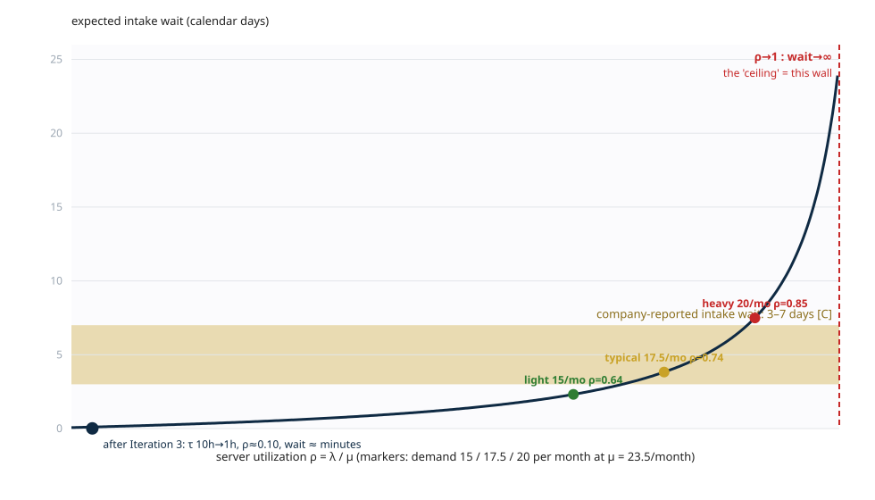
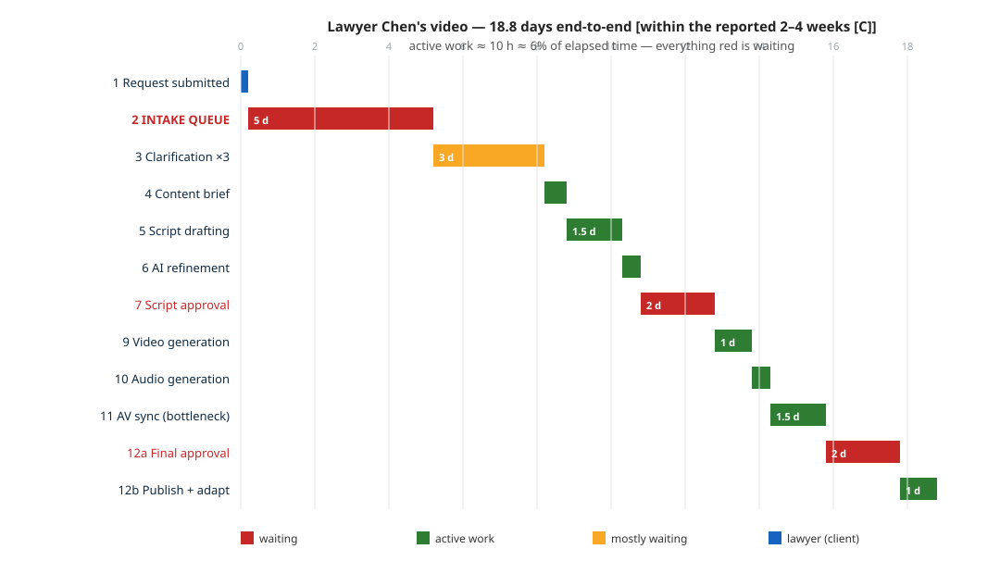
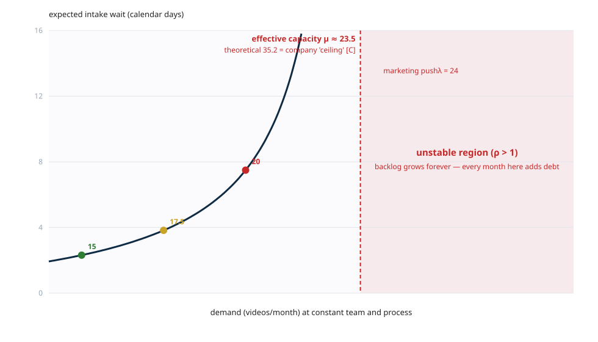
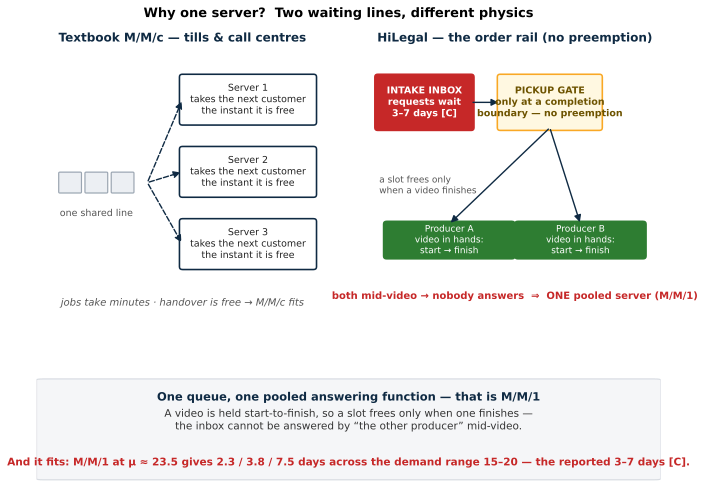

# The queueing model — everything in one file

**What this is:** the complete queueing-theory treatment of HiLegal's intake queue — the model, the calibration, the predictions, the persuasion pack for presenting it, and a guide to every chart. Everything that used to be spread across the section notes now lives here.

**Inputs used (all traceable):** demand λ = 15–20 videos/month [C] · intake wait 3–7 days, "workload-dependent" [C] · ~10 h labour per video, 2 producers [C] · company-stated ceiling 35–40/month [C] · fully-loaded producer rate ¥85/h [E] · working month = 22 days; 1 working day ≈ 1.4 calendar days.

**How the file is organized:**
- **Part A** — the model built from zero, in plain language, with every calculation shown
- **Part B** — how to *persuade* the room that the team is one processing unit and M/M/1 is the right model
- **Part C** — the four SVG charts: what each shows, how to read it, when to show it
- **Part D** — cheat sheet and likely Q&A
- **Part E** — how to run `queue_model.py`

---

# Part A — The model, from zero

## A0. The question

A lawyer sends a video request; it sits **3–7 days in the intake queue** before anyone looks at it [C]. HiLegal says the wait is *"workload-dependent"* [C]. The question the audience will ask: **is that wait because the team is slow, or is it inevitable?**

The model answers: given how requests arrive and how the team works, 3–7 days is exactly what the mathematics predicts. Nobody is slacking — the process sits on the steep part of a curve. That distinction decides which fixes can work.

A queueing model is just a **calculator for waiting lines**: feed it how fast work arrives and how fast work gets done; it returns how long things wait and how many pile up.

## A1. The waiting line

Strip away the twelve steps. From the intake queue's point of view:

```
  lawyer requests            the inbox                 the team
  (arrivals)                  (the queue)              (the "server")

  ──► ──► ──► ──►   [ request ][ request ][ request ] ──► ┌─────────┐
                          WAITING                        │ producer │──► video
                         (3–7 days!)                     │ picks up │    delivered
                                                        │ & makes  │
                                                        └─────────┘
```

- **Customers** = video requests.
- **Queue** = the intake inbox where requests sit untouched.
- **Server** = the team that eventually picks a request up and produces it.

**Why is the server "1" and not "2"?** Think of the team as **one processing unit**. Either producer *may* answer the inbox — but neither *may interrupt* a video at 60% to do it: creative work cannot be paused and resumed losslessly, so pickups happen only at completion boundaries. When both producers are mid-video, **nobody answers**, and requests stack. From the inbox's perspective, what matters is not how many humans exist but the rate at which the *unit* frees a slot — so we model one pooled server with the team's combined speed.

That said, two producers occasionally *do* overlap (one video waits at a client approval while its producer starts the next) — the two-server view. We don't argue it away; we compute it in **A5**. The two-server model shortens the expected wait by only ~15%, both models land inside the observed band, and every conclusion is identical. M/M/1 is the conservative, transparent member of the family — if the pessimistic model already explains reality, the optimistic one does too. And with the CEO-reported churn spiral (Section 2), the "two servers" are not reliably two anyway.

## A2. The three numbers: λ, μ, ρ

| Symbol | Name | In HiLegal's world | Value |
|---|---|---|---|
| **λ** (lambda) | arrival rate | video requests arriving per month | **15–20/month [C]** (typical 17.5) |
| **μ** (mu) | service rate | videos the team can pick up and produce per month when continuously fed | **≈ 23.5/month** — unknown, calibrated in A6 |
| **ρ** (rho) | utilization | fraction of capacity used | **ρ = λ / μ** |

Work in **working days** (22/month); convert to calendar days by ×1.4 (weekends).

**ρ is the analysis.** Two readings: (1) the fraction of time the team is occupied; (2) in M/M/1, approximately the probability a newly arriving request finds the team busy and must wait. At typical demand ρ = 17.5 ÷ 23.5 = **0.74** — ~74% of arrivals find the team occupied. That is why the queue exists.

## A3. Why a queue exists despite spare capacity (randomness)

Requests arrive from many independent lawyers: some weeks six, some weeks none. When a burst lands while the team is mid-video, the burst piles up. Spare capacity exists *on average over the month*, not *at the moment a request arrives*. A queue is the price of randomness around a high average load.

This is why arrivals are modeled as **Poisson** — the standard model for many independent customers arriving at random. The "M" in M/M/1 stands for *Markovian* (memoryless): knowing no request arrived in the last three days tells you nothing about tomorrow. Every moment is a fresh coin flip with the same odds.

## A4. What "M/M/1" means (Kendall notation)

| Position | Ours | Meaning |
|---|---|---|
| A — arrival process | **M** | random, Poisson arrivals |
| S — service process | **M** | random service times (most videos smooth, some blow up with rework; the mean is what matters) |
| c — servers | **1** | one pooled pickup process (A1) |

M/M/1 is the simplest model that is still honest about randomness — deliberately the textbook base case, refined by Kingman's equation (A9) for variability.

## A5. The M/M/2 objection, answered with numbers

The natural objection: *"Two producers — isn't the honest model M/M/2?"* We compute the alternative (Erlang's C formula, `queue_model.py` Part 1b) at the same aggregate capacity μ = 23.5/month, split as two servers of 11.75 each:

| λ | M/M/1 wait | M/M/2 wait (Erlang C) | observed [C] |
|---|---|---|---|
| 15 | 2.3 d | 1.8 d | ~3 d |
| **17.5** | **3.8 d** | **3.3 d** | **3–7 d** |
| 20 | 7.5 d | 6.9 d | ~7 d |

Three observations:

1. **The difference is ~15%, not a factor of two.** At ρ ≈ 0.75–0.85 both producers are busy most of the time anyway; the M/M/2 advantage only appears when one server is idle, which is rare on the steep part of the curve.
2. **Both models sit inside the observed band** → the calibration is robust to server choice. We report M/M/1 because it is conservative (longer waits) and simpler to defend.
3. **Every conclusion is identical** — the cliff, the ×3 nonlinearity, the ρ = 1 wall, the Iteration-3 prescription. The utilization level carries the story, not the model family.

Where does reality sit? Between the two: each producer juggles 1–2 staggered videos (Little's Law: ≈3–6 in system), while client-gate stalls make a producer unavailable without being "busy" — pushing behavior back toward the pooled-unit view.

## A6. The calibration: how μ ≈ 23.5 was found

Known: λ (15–20/month [C]) and the observed wait (3–7 days [C]). Unknown: μ. Fit the one unknown to the one observation, then verify independently.

**Attempt 1 — "100% dedicated":** μ = 35.2 (= 2 × 176 h ÷ 10 h). Then ρ = 17.5/35.2 = 0.50 and Wq = [0.50/0.50] × (22/35.2) = 0.62 wd ≈ **0.9 calendar days**. Reality says 3–7. ❌ The team is not instantly available — producers do platform work too; pickups wait for windows.

**Attempt 2 — μ = 23.5/month:**

| λ | ρ | multiplier ρ/(1−ρ) | τ (wd) | Wq (wd) | Wq (calendar) | observed |
|---|---|---|---|---|---|---|
| 15 | 0.64 | 1.76 | 0.94 | 1.65 | **2.3 d** | ~3 d |
| 17.5 | 0.74 | 2.92 | 0.94 | 2.73 | **3.8 d** | 3–7 d |
| 20 | 0.85 | 5.72 | 0.94 | 5.36 | **7.5 d** | ~7 d |

✅ The model reproduces the whole observed band — including its workload-dependence.

**Independent check (why this is science, not curve-fitting):** μ = 23.5 × 10 h = **235 h/month**; available = 2 × 176 = 352 h → **67% dedication**. Plausible for two people who also do platform work, and it matches the ~65% availability assumed in `kpi-data.md` from different reasoning. Bonus: theoretical 100%-dedication capacity 35.2 matches the company-stated ceiling 35–40 [C].

## A7. The whiteboard derivation (memorize this one)

```
λ  = 17.5 requests/month          (company data [C])
μ  = 23.5 videos/month            (calibrated, A6)

ρ  = λ/μ = 17.5/23.5              = 0.74
τ  = 1/μ = 22/23.5                = 0.94 working days
Wq = ρ/(1−ρ) × τ = 0.74/0.26 × 0.94 = 2.73 working days
                 × 1.4 (weekends) = 3.8 calendar days   ✓ inside 3–7 [C]
```

Four lines; every input either company-reported or independently sanity-checked.

## A8. The formulas, and the villain

```
ρ  = λ / μ
Wq = [ ρ / (1−ρ) ] × τ          τ = 1/μ in working days
      └ congestion ┘ └ time scale ┘
```

**Wait = how congested × how long one "turn" takes.** The congestion multiplier is the villain:

| ρ | 0.50 | 0.60 | 0.70 | **0.74** | 0.80 | 0.85 | 0.90 | 0.95 | 0.99 |
|---|---|---|---|---|---|---|---|---|---|
| ρ/(1−ρ) | 1.0 | 1.5 | 2.3 | **2.9** | 4.0 | 5.7 | 9.0 | 19.0 | 99.0 |

At ρ = 0.74 every ~1-day "turn" of work drags ~3 days of queue behind it. As ρ → 1 the multiplier → ∞. **That curve is the entire story of the intake queue.**

## A9. Predictions (what the model says beyond the average)

**How many requests are parked in the inbox right now?**
Little's Law: `L = λ × W` — things in system = arrival rate × time each spends. Queue-only: Lq = (17.5/22 per wd) × 2.73 wd = **2.2 requests** parked at a typical moment; up to ~5 in a heavy month. **This is the falsifiable prediction** — ask HiLegal to count the inbox. If it typically holds 2–5, the model is confirmed. (If it *never* holds more than one, the delay is batch-review cadence instead — A13 — and Iteration 1 kills either mechanism.)

**The tail — how bad can one lawyer's wait get?**

```
P(wait > 5 d)  = 28%
P(wait > 7 d)  = 19%    ← 1 in 5 lawyers waits over a week
P(wait > 10 d) = 11%    ← 1 in 10 waits ~two weeks
P(wait > 14 d) =  5%
P90 ≈ 10 calendar days
```

This is *just the intake queue* — production hasn't started. "Workload-dependent" [C] **is** this fat tail.

**Nonlinearity — why "working harder" fails:** demand 15 → 20/month is ×1.33; the wait 2.3 → 7.5 days is **×3.2**. A 33% increase in work produced a 220% increase in waiting, because the process moved up the multiplier ladder. Effort changes λ or μ a little; the multiplier turns little changes into big waits.

**The ceiling is a wall:** if λ ≥ μ, ρ ≥ 1 ⇒ Wq → ∞ and backlog grows forever. The company's stated ceiling 35–40 [C] sits essentially at ρ = 1 (theoretical 35.2). "Pushing to 35/month" is a mathematical promise of unbounded waiting; at λ = 24/month the queue never drains.

## A10. Kingman's VUT equation (variability)

M/M/1 assumes standard randomness. Reality has more: arrivals are lumpier than random (marketing pushes — **c_a²**), and service times are uneven (≥4 rework loops [C] — **c_s²**).

```
Wq ≈ [ ρ/(1−ρ) ] × [ (c_a² + c_s²)/2 ] × τ
        Utilization      Variability       Time
```

M/M/1 is the special case c_a² = c_s² = 1. With HiLegal's numbers:

| Scenario | c_a² | c_s² | Expected wait |
|---|---|---|---|
| Steady demand, stable jobs | 1.0 | 0.5 | ≈ 2.9 d |
| Typical (bursts + loops) | 1.2 | 1.0 | ≈ 4.2 d |
| Marketing push + heavy rework | 1.5 | 1.5 | ≈ 11.2 d |

Same team, same average load — variability alone triples the wait. This explains months that blow past 7 days without anyone slacking. It also previews the fix: templates and structured briefs attack V and U; automation attacks T.

## A11. The simulation validation

Formulas can feel like magic, so Part 4 of the script reality-checks them: generate 200,000 requests with random arrivals (rate λ) and random service (rate μ), run them through a strict FIFO single server, average the waits, compare.

Result: **simulation 3.8 d vs formula 3.8 d (0.7% apart); at λ=20: 7.4 vs 7.5 (1.2%)**. The formula is not a symbol game — it is what happens when you run the process.

## A12. What the theory prescribes (bridge to Section 6)

Three levers, and the three iterations pull them in the right order:

| Model term | Meaning | Iteration | Effect (model output) |
|---|---|---|---|
| **delete the server** | intake stops being a staffed queue: self-serve form + auto-routing | **Iteration 1** | Wq → 0 **by design** (no ρ-tweaking could do this) |
| **cut τ** | 10 h → 5.8 h → 1 h per video | Iterations 2–3 | ρ: 0.74 → 0.43 → 0.07; Wq: 3.8 d → 0.6 d → **≈ 4 minutes** |
| **cut variability** | templates + SLA'd structured briefs kill bursts and loops | Iterations 1–2 | removes the ×1.5–2 variability penalty at constant load |

**The line to say on stage:** *"At ρ = 0.8, the waiting is not a people problem — it is the mathematics. You cannot stand slightly left of a cliff. You either delete the server or leave the cliff."*

## A13. Model card & limitations (state these on purpose)

1. **μ is calibrated, not measured** [E] — one knob fitted to one observation, then verified via labor accounting (67%) and simulation. That is good practice, but it is an estimate.
2. **Poisson arrivals are an assumption** — defensible (independent lawyers), with Kingman's c_a² covering lumpier demand.
3. **M/M/1 is a simplification** — real service times aren't exponential; the team is two humans, not one server. Chosen deliberately: conservative and transparent. (M/M/2 computed in A5: same band.)
4. **Steady state assumed** — a normal month, not a launch transient.
5. **Falsifiability:** if the inbox never holds more than ~1 pending request while waits still run 3–7 days, the delay is **batch-review cadence** (producers checking intake twice a week — a polling/vacation model), not classic queueing. Either mechanism is eliminated by Iteration 1, so the prescription is robust even if the diagnosis is uncertain.
6. **Scope:** the intake queue only. Approval-gate waits (client-side, 1–3 days each) sit on top and account for the rest of the 2–4 weeks [C].
7. **The server itself can fail:** Section 2's CEO-reported HR spiral (around-the-clock work, resignations, ramp-up months) means μ degrades exactly when demand is heavy; if the 15–20/month output is propped up by overtime, true utilization is even closer to the ρ = 1 wall than modeled. **Reality is likely worse than the model, not better.**

---

# Part B — Persuading the room

## B1. The one-sentence claim

> **"We don't model two employees. We model one processing unit — and we chose the conservative model, tested its main alternative, and showed it reproduces HiLegal's own 3–7 day reality."**

## B2. The 60-second pitch (say it verbatim)

> "Before the numbers: what are we actually modeling? Not two people — **one processing unit**. A video is picked up by one producer and held start-to-finish, because you cannot pause a video at 60% and hand half of it to a colleague. So when both producers are mid-video, **nobody answers the inbox** — and the request waits. From the request's point of view, only one thing matters: when does the unit free a slot? That is a single queue served by a single pooled answering function — M/M/1.
>
> But don't take our word for the modeling choice. We tested the alternative: if you insist on two servers, Erlang's formula gives 3.3 days instead of 3.8 — the same 3–7 day band, the same conclusions. And notice the direction of our assumption: **we kept the model that predicts *longer* waits**. If the pessimistic model already matches HiLegal's reality, the optimistic one isn't going to save the argument. That's why M/M/1 — not because it is simple, but because it is the **honest, conservative, verified level of abstraction**."

Why it works: it preempts the objection before the audience raises it, turns the modeling choice into evidence of rigor, and never asks the room to "trust us" — it shows the fit.

## B3. Three pillars for "one server"

1. **The queue sees pickups, not people.** The thing being explained is the inbox; its behavior is defined by how often a slot frees, not by headcount. A request waits until *someone* can take it; when both producers are mid-video, the answer is nobody. Inside the unit, work is organized however it is organized — the line outside doesn't see it.
2. **No preemption — video is not a call centre.** A call-centre agent takes the next caller the instant they hang up: minutes-long jobs, free handover. A video occupies a person for days of calendar time, and creative work cannot be paused and resumed losslessly. Pickups happen only at **completion boundaries** — serial by nature. That contrast is exactly why M/M/c is right for tills and wrong here.
3. **The internal division of labour is invisible to the queue.** Two producers, two hundred, or one fast producer: if the aggregate pickup rate is the same, the line behaves the same. And the company reports one aggregate number (15–20/month). More detail would be false precision — a model should be as complex as the data allows, not more.

Lean framing: *"We treat the team the way operations treats any process — input, transformation, output, one capacity. We are not modeling the kitchen's internal stations; we are modeling the order rail."*

## B4. Why the team is the server (not the inbox, not each step)

| Thing | Role in the model | Why |
|---|---|---|
| The inbox | **The queue** (where requests wait) | Stores demand; adds no value |
| The producers | **The server** (what removes requests and adds value) | They are the capacity |
| The 12 steps | **Inside the server** | Internal structure, invisible to the front line |

Why not model all 12 steps as a queueing network? (a) no per-step arrival/service data; (b) the dominant wait happens **before step 1** — 3–7 days is larger than any internal queue; (c) the rest is covered by the labor waterfall (Section 5) and the Section 7 simulation. **Choosing where to spend modeling effort is itself an operations decision — we model the binding constraint, not the org chart.**

## B5. The killer move: we computed the alternative

Most teams assert "M/M/1 is fine." We tested it (A5, Erlang C). Say out loud: **"The two-server view buys 15%, not a different story."** Both sit in the band; cliff, nonlinearity, wall and prescriptions identical. Then the turn:

> **"We deliberately kept the model that predicts longer waits. An assumption that works against your own argument is the most credible kind."**

If someone still doubts single-server: point out the direction of the doubt — with churn and overtime (Section 2), the real unit is slower and less stable than modeled. **Doubting our assumption makes reality worse, not the model better.**

## B6. The analogies

**The kitchen order rail** (primary):
> "Two cooks, one rail of orders. Orders are not cooked half by each cook — each goes to one cook start-to-finish. From the rail's view, the kitchen frees a slot when *a* cook finishes a dish. If both are mid-dish, the rail waits. One line, one pooled 'can-take-next' function."

**The supermarket contrast** (shows mastery):
> "A supermarket till is textbook M/M/c: jobs take seconds, and a free till takes the next customer instantly. Our jobs take *days*, and nobody can be handed a half-finished video. Same words — 'waiting line' — different physics."

**The reception desk one-liner:** "Two people behind one desk: the visitor doesn't care who looks up — only whether *anyone* looks up. That 'anyone' is our single server."

## B7. Objection → response table

| If they say… | You answer… |
|---|---|
| "Two producers — why not M/M/2?" | "We computed it: 3.3 vs 3.8 days, ~15%, same band and conclusions. We kept the conservative model on purpose — and with churn the 'two servers' aren't reliably two anyway." |
| "Why is the team one server, not each producer?" | "No preemption: videos are held start-to-finish, so pickups happen only at completion boundaries. The inbox sees one answering function — either a slot is free or nobody answers." |
| "Why isn't the inbox the server?" | "The inbox is the queue — it stores requests, adds no value. The team is the capacity that removes them." |
| "Why not model all twelve steps as a network?" | "No per-step data, and the dominant wait is before step 1. We model the binding constraint; the waterfall and Section 7 cover the rest." |
| "Poisson arrivals — really?" | "Independent lawyers, no coordination — the standard model. Lumpy demand is stress-tested with Kingman's c_a²; bursts only make waits worse, strengthening the conclusion." |
| "Exponential service times?" | "Service varies wildly — 6 to 25 hours with approval loops. Exponential is the max-uncertainty choice given a mean; deviations are covered by the Kingman sensitivity." |
| "Isn't fitting μ circular?" | "One knob, one observation — then verified two other ways: 67% dedication matches the independent availability estimate, and the model reproduces the *shape* (workload-dependence), not just one number. A simulation matches within 1%." |
| "Why 3.8 and not 3–7?" | "3.8 is the typical-month point estimate; across the demand range the model gives 2.3–7.5 — that *is* the reported band, including its workload-dependence." |
| "So the team is lazy?" | "Opposite. At ρ ≈ 0.74–0.85 the waiting is the mathematics of utilization. That's why the fixes are structural, not motivational." |
| "Couldn't another model disagree?" | "We tested the main alternative; it agrees within 15%. The conclusions depend on the utilization level, not the model family — which is what the cliff chart shows." |

## B8. Delivery choreography (five beats, ~90 seconds)

1. **Phenomenon first, model later.** Show the 3–7 day wait; ask the naive question: "why doesn't the team just answer faster?"
2. **Reveal the abstraction.** "A video is held start-to-finish — the team behaves as one processing unit." Put up `why-one-server.svg`.
3. **Show the fit.** "M/M/1 at μ ≈ 23.5 gives 3.8 days — inside the band — and 2.3–7.5 across the demand range." Point at the calibration table.
4. **Preempt the objection.** "Two producers, M/M/2? We computed it — 15%, same band." Point at the bottom band of the figure.
5. **Land the conservative line**, then move on.

Never open with "we chose M/M/1 because…" — the audience must first *feel* the phenomenon, then meet the model as the answer to a question they now care about.

## B9. Language bank

| Avoid | Use instead | Why |
|---|---|---|
| "We assumed M/M/1" | "We tested M/M/1 against the alternative and the data" | Assumption sounds arbitrary; test sounds earned |
| "It's a simple model" | "It's the leanest model that reproduces the data" | Simple sounds lazy; lean sounds deliberate |
| "I think the team is one server" | "Pickups are serial, so the inbox sees one answering function" | Mechanism beats opinion |
| "The model is probably right" | "The model reproduces the observed band and the workload-dependence" | Fit beats belief |
| "Two producers, so maybe M/M/2" (from you) | "We computed M/M/2: same band; we kept the conservative model" | Never leave an objection for the audience to raise first |

## B10. What we are NOT claiming

- Not that every order waits exactly 3.8 days — that's a typical-month expectation; individual waits are a distribution with a fat tail.
- Not that the team is literally one person — that the *pickup process* behaves as one pooled unit.
- Not that M/M/1 is the only defensible model — that it is the conservative, data-compatible one, and the alternative was tested and agrees.
- Not that the model covers the whole pipeline — it explains the intake queue, the largest single wait; the rest is handled by the waterfall and the Section 7 simulation.

## B11. If you remember only one line

> **"We chose the model that predicts longer waits — and it still matches reality. That's not a weakness of the model; that's the argument."**

---

# Part C — The four charts

*(Three are generated by `queue_model.py`; the model-choice slide is a hand-authored figure. All four live in this folder.)*

## C1. `queue-cliff.svg` — the utilization cliff (THE chart)



**What it shows:** expected intake wait (calendar days, y-axis) against server utilization ρ (x-axis) for the M/M/1 model — the drawn curve is Wq = [ρ/(1−ρ)] × τ. The gold band is the **company-reported 3–7 day wait [C]**; the three dots are light/typical/heavy months (λ = 15 / 17.5 / 20 at μ = 23.5); the red dashed line at ρ→1 is annotated "the 'ceiling' = this wall"; the navy star far left is the process after **Iteration 3** (τ: 10 h → 1 h, ρ ≈ 0.10, wait ≈ minutes).

**How to read it:** the curve is a cliff, not a slope. At ρ = 0.5 the wait is ~1 turn; at 0.74 it is ~3 turns; at 0.95 it is ~19 turns; at 1.0 it is infinite. Small moves up the curve produce enormous moves in waiting — that is why effort cannot fix this process.

**When to show it:** the centrepiece of Section 3 (and referenced again in Sections 4 and 7). Pair with the line: *"You cannot stand slightly left of a cliff — you either delete the server or leave the cliff."*

## C2. `order-timeline.svg` — one order, work vs. wait



**What it shows:** Lawyer Chen's video traced through the 12 steps in calendar days (x-axis): green bars = active work, red = waiting, amber = clarification (mostly waiting), blue = the lawyer's own action. The **INTAKE QUEUE block (5 days) is the first big red bar**; the total is 18.8 days — inside the reported 2–4 weeks [C] — while active work is only ~10 hours ≈ 6% of elapsed time.

**How to read it:** red dominates. The process is a waiting line with work sprinkled in; the largest single red block sits before the first step of real work. (Block lengths are elapsed days per step; the total active labour remains the company-reported ~10 h [C].)

**When to show it:** during the one-order walkthrough in Section 3 — it makes "queue-gated, not work-gated" visible in one glance. Also useful in Section 2's lawyer-perspective argument (their campaign calendar inherits this red).

## C3. `demand-sweep.svg` — why scaling breaks



**What it shows:** expected intake wait (y-axis) against monthly demand λ (x-axis) at constant team and process (μ ≈ 23.5). The curve asymptotes at the effective capacity; the red-shaded region right of it is **unstable (ρ > 1)** — every month there adds permanent backlog. Markers sit at the observed demand range (15 / 17.5 / 20); the annotation notes that the theoretical 100%-dedication capacity 35.2 equals the company-stated ceiling 35–40 [C].

**How to read it:** wait is nearly flat at low demand, then bends upward and goes vertical at μ. There is no "safe" operating point near the ceiling — the last third of the curve is a different regime, where a marketing push converts directly into backlog.

**When to show it:** when discussing scale and the "ceiling" (Sections 2–4), or in Section 7's demand-surgence scenario. Pair with: *"You can raise demand or you can raise capacity — near μ, demand becomes queue."*

## C4. `why-one-server.svg` — the model-choice slide



**What it shows:** a split panel. **Left:** textbook M/M/c (tills / call centre) — one queue, instant dispatch to free agents, minutes-long jobs, free handover: the regime where M/M/c belongs. **Right:** HiLegal's order rail — the intake inbox in red ("3–7 days [C]"), a pickup gate labeled *"only at a completion boundary — no preemption"*, and two producers each holding a "video in hands — start → finish" bar. **Bottom band:** the M/M/2 test numbers (Erlang C 1.8 / 3.3 / 6.9 d vs M/M/1 2.3 / 3.8 / 7.5 d) and the conservative-design line.

**How to read it:** the two panels are the same waiting line under different physics. Left: a free server can answer *now*. Right: a slot frees only when a video *finishes* — so the inbox sees one pooled answering function. The bottom band proves the choice is safe: the alternative model changes the wait ~15%, not the story.

**When to show it:** at the "why M/M/1" moment in Section 3 (Part B's 60-second pitch goes with it). It is the only chart that argues the *model choice* rather than the *result*.

---

# Part D — Cheat sheet & likely Q&A

| Symbol | Read it as | HiLegal value | Source |
|---|---|---|---|
| λ | requests arriving per month | 15–20 [C] | company-reported output |
| μ | videos the team can handle per month | ≈ 23.5 [E] | calibrated (A6) |
| ρ = λ/μ | utilization; ≈ chance a new request must wait | 0.64–0.85 | derived |
| τ = 1/μ | one video's "turn" | ≈ 0.94 wd | derived |
| Wq = ρ/(1−ρ) × τ | expected intake wait | 2.3–7.5 d | M/M/1 formula — matches [C] |
| Lq = λ × Wq | requests parked in the inbox | 2–5 | Little's Law — falsifiable |
| c_a², c_s² | arrival / service lumpiness | 1.0–1.5 [E] | scenario values |
| Kingman | wait with real-world lumpiness | up to ~11 d | VUT equation |

**Likely questions and one-line answers:** see B7 (objection → response table). Model-limitation answers: see A13. Chart questions: see Part C.

---

# Part E — Running the model

```
python3 queue_model.py
```

No dependencies. Prints, in order:
1. **Part 1** — calibration of μ against the observed 3–7 day wait + three reality checks
2. **Part 1b** — the M/M/2 robustness check (Erlang C)
3. **Part 2** — predictions: Lq, tail probabilities, P90, the nonlinearity, the ρ = 1 wall
4. **Part 3** — Kingman VUT scenarios + what the iterations do to the queue
5. **Part 4** — discrete-event simulation validating the formulas (±1%)
6. **Part 5** — writes `queue-cliff.svg`, `order-timeline.svg`, `demand-sweep.svg`

Change any input in the `Parameters` block at the top of the script (λ, μ, hours, rates) and every table and chart updates consistently.
