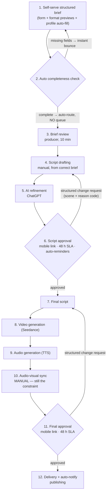

# Iteration 1 — Standardize briefing and approvals

**Position in the chain:** the front door. Attacks the root causes of *waiting* (unstructured intake, 3–7 d queue [C]) and *rework* (brief loops ≥4 iterations [C], un-SLA'd email approvals). No new AI — this is pure process design, which is exactly why it goes first: cheapest, fastest, and it produces the structured Brief data that Iterations 2 and 3 are built on.

**Deliverable name for the demo:** *HiLegal Studio v1 — Intake & Approvals*

---

## 1. Problem addressed (with numbers)

| Symptom | Evidence | Root cause (Section 4) |
|---|---|---|
| 3–7 days pass before work even starts | Intake queue [C] | Free-form requests must be clarified by email before briefing |
| Brief approval loop runs ≥4 iterations [C] | Company-reported | No format previews; lawyer can't see what they'll get; feedback is free-text |
| ~90% of videos need rework [E] | Derived | Unstructured approvals: no SLA, no scene-level change requests, manual chasing |
| 21-day lead time driven ~94% by waiting | Little's Law analysis | Three looping gates + intake queue |

## 2. Change introduced

1. **Structured self-serve intake form** (in HiLegal Studio, web + mobile): 12 fields — video format (from a catalogue of 5), objective, practice areas, target audience, language(s), tone, key messages, length, avatar consent flag, deadline, asset links, notes. **Format previews** (30-second animated examples) shown at selection time — the lawyer sees the end-shape before requesting.
2. **Profile auto-fill**: practice areas, credentials, languages, photo pulled from the lawyer's platform profile (`GET /profiles/{id}`).
3. **Auto completeness check & routing**: incomplete briefs are bounced back instantly with specific missing fields — **the intake queue and the clarification loop are deleted at the source**. Complete briefs route directly to a producer.
4. **SLA'd mobile approval links**: script approval and final approval move from email threads to structured links — approve / request change, with **change requests tied to a specific scene and a reason code** (drop-down + free text). **48 h SLA per gate, auto-reminders at 24 h and 40 h, escalation to phone at 48 h.**
5. **Order state machine + timestamps**: every transition logged (this is the measurement habit the current process lacks — the proposal's PDCA requirement, delivered as a side effect).

## 3. Updated process map (12 → 10 steps)

**What fused/disappeared vs. baseline:** Intake Queue + Clarification (steps 2–3 of as-is) collapse into the form + auto-check; approvals become instrumented gates with SLAs. **What is deliberately untouched:** the manual production middle (drafting, generation, sync) — that is Iterations 2–3's job.

## 4. API deltas vs. baseline (v1 surface)

Baseline has no system APIs — coordination runs on email/Excel. Iteration 1 introduces the order spine:

| Endpoint | Purpose | Notes |
|---|---|---|
| `GET /v1/templates` | 5 video format cards with previews | lawyer intro · practice-area explainer · client testimonial · FAQ · case study |
| `GET /v1/profiles/{lawyerId}` | Auto-fill fields from platform profile | kills re-typing, ensures data quality |
| `POST /v1/requests` | Submit structured brief (12-field schema) | validated server-side; stored as **Brief JSON** — *the artifact Iterations 2–3 consume* |
| `GET /v1/requests/{id}` | Order state machine | `submitted → auto_check → brief_ok → scripting → script_ready → client_approval → production → final_approval → delivered` — every transition timestamped |
| `POST /v1/requests/{id}/approval` | Structured approve / change-request | change request = `{scene, reason_code, note}` |
| `POST /v1/reminders` | SLA timer engine | 48 h/gate, reminders at 24 h/40 h, escalation webhook |
| Webhooks | `request.submitted`, `approval.granted`, `sla.breach` | feeds the dashboard + KPI logging |

**Consumed by later iterations:** Brief JSON (`requests/{id}`) is the input contract for Iteration 2's script engine. Iteration 1's approval machinery is also what makes Iteration 3's 1–2-day lead time possible (SLA-capped client gates) — front-end work paying off twice.

## 5. KPI effect

| KPI | Baseline | **Iter 1** | Δ vs. baseline | Mechanism |
|---|---:|---:|---:|---|
| Lead time | ~21 d (14–28) [C] | **~9 d (7–12) [T]** | −57% | Queue deleted; clarification loop deleted; gates SLA-capped |
| Human time | 10 h 00 [C] | **7 h 15 [T]** | −28% | Intake/clarification 60→15 min; brief 50→10; fewer redo rounds in drafting/sync/adaptation |
| Cost/video | ¥940 [E] | **¥705 [T]** | −25% | Labour only; tools unchanged |
| Capacity | ~19/mo | **~26/mo [T]** | +37% | 435 min/video at same staffing |
| Rework rate | ~90% [E] | **~55% [T]** | −35 pts | Brief/clarification loops eliminated at source |
| QAR | ~10% [E] | **~45% [T]** | +35 pts | Format previews + structured change requests |

Full waterfall: `05 .../kpi-data.md` §1–2.

## 6. KPI-check methodology (how we verify — the pilot gate)

**Pilot design:** 10 videos run through v1 while 10 concurrent requests run through the legacy path (same weeks, same producers).
**Instrumentation:** state-machine timestamps give lead time, gate wait times, and loop counts automatically; producers log active minutes in a simple timer.
**Pass criteria (all must hold):**

| Check | Threshold | Fails if |
|---|---|---|
| Lead time (median of pilot batch) | ≤ 12 calendar days | > 12 d → SLA compliance investigation (who breached: client or process?) |
| Clarification-loop count | 0 loops on ≥ 8/10 videos | loops recur → form fields/previews insufficient → revise form, not the SLA |
| Human time | ≤ 8 h/video average | > 8 h → producers working around the tool |
| Rework rate | ≤ 60% | > 60% → change-request reason codes don't map to real edits |
| QAR | ≥ 35% | — |
| **Guardrail:** video quality | No drop in client satisfaction vs. legacy batch | faster but worse = fail |

**Review cadence:** weekly PDCA review of the dashboard; adjust form fields, previews, and reminder timing based on reason-code frequencies.

## 7. Remaining limitation (the setup for Iteration 2)

- Labour is still **7 h 15**, of which ~6 h 40 is the manual production middle (drafting 55 + script editing 25 + video gen 60 + audio gen 35 + sync 135 + adaptation 90 min — see the waterfall in `05 .../kpi-data.md` §1). The front end is fixed; **the middle is untouched.**
- Producers now spend their freed hours almost entirely on writing scripts and synchronizing audio-video — **manual scripting is the next constraint to attack, and it needs structured Briefs to automate — which now exist.**
- One-line bridge: *"We standardized what the client sends us. Now let's make the machine do the writing."*

## 8. Risks & guardrails

| Risk | Mitigation |
|---|---|
| Lawyers don't fill forms (adoption) | Form pre-filled from profile (≤ 3 manual fields); format previews make it self-explanatory; producer-assisted fallback for the first cohort |
| 48 h SLA breached by lawyer (client-side wait now dominates) | Auto-reminders + phone escalation; SLA stated in the subscription terms |
| Structured change requests feel rigid | Free-text note always available alongside reason codes; producer can call — but the call outcome is logged into the same structure |
| Producers bypass the system | The system IS the delivery channel (auto-notify, publishing) — no shadow path |
