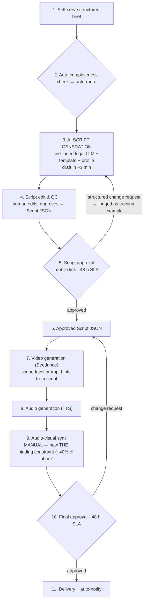

# Iteration 2 — Template-based AI scripting

**Position in the chain:** the middle. Iteration 1 standardized what clients send; Iteration 2 automates what employees write. It **reverses today's automation order** — the current process drafts manually and uses AI only to refine; from here the **fine-tuned legal LLM drafts** from template + lawyer profile, and humans **edit instead of write**. This is also the strategic pivot of the whole project: the video process becomes a training-ground and usage engine for HiLegal's core asset, the lawyer LLM.

**Deliverable name for the demo:** *HiLegal Studio v2 — Script Engine*

---

## 1. Problem addressed (numbers as left by Iteration 1)

| Symptom after Iteration 1 | Evidence | Root cause (Section 4, chain 2) |
|---|---|---|
| Script work still costs 80 min/video (drafting 55 + editing 25) | Waterfall §1 | Human writes the first draft; AI only refines — automation order inverted |
| Script-surprise loops remain (~55% rework) | Loop counter | Lawyer approves structure only after reading a bespoke draft — surprises are structural |
| Labour 7 h 15: the manual middle dominates | Waterfall §1 | No structured data spine downstream of the brief — generation steps can't be automated |

**Prerequisite check (why this must come second):** the model consumes **Brief JSON** — format, objective, tone, length, languages, key messages. Without Iteration 1's form this data does not exist in machine-readable form. **Iteration 1 is not optional infrastructure for Iteration 2; it is the input contract.**

## 2. Change introduced

1. **Script Engine**: `POST /v2/scripts/generate` takes the Brief JSON + lawyer profile and produces a full script **draft** through HiLegal's fine-tuned legal LLM against a fixed template.
2. **Template library (5 formats, extending Iteration 1's catalogue)**: each template is a scene skeleton with tone rules, pacing, and **built-in legal-marketing compliance constraints** (no outcome guarantees, disclaimer handling, jurisdiction statements) — compliance moves from memory to system.
3. **Profile-enriched drafting**: credentials, case highlights, languages, and **past accepted edits** are injected as few-shot examples — the model writes *like this lawyer's previously approved videos*.
4. **Human edit-not-write QC (step 4 of the to-be)**: producer reviews the draft in a scene editor, fixes edge cases, approves → script becomes the **approved Script JSON: scenes[], voiceover_text, on_screen_text[], duration, prompt hints** — a single source of truth for every downstream step.
5. **Structured change requests feed the model (the fine-tuning flywheel)**: every lawyer change request (scene + reason code — Iteration 1's machinery) and every producer edit is logged as a labelled example. Accepted/rejected edits become **fine-tuning data for the legal LLM** — the video process now *generates* the asset HiLegal most wants to improve. (This is the sentence that ties the project to the company's strategy — say it in the presentation.)

## 3. Updated process map (10 → 9 steps)

**What fused vs. Iteration 1:** steps 4–5 (drafting + AI refinement, 80 min) collapse into generation (5 min) + edit-QC (30 min). **What is deliberately untouched:** generation + sync + adaptation — Iteration 3's target, now fatter than ever in relative terms.

## 4. API deltas vs. Iteration 1 (v2 surface — additive, nothing breaks)

| Endpoint | Type | Purpose |
|---|---|---|
| `POST /v2/scripts/generate` | **new** | Brief JSON → script draft (scenes, voiceover, on-screen text, prompt hints); model = HiLegal fine-tuned legal LLM, self-hosted (~¥20/video inference [E]) |
| `GET /v2/templates/{id}` | **new** | Template = scene skeleton + tone rules + compliance constraints |
| `GET /v2/profiles/{lawyerId}` | **extended** | + credentials, case highlights, **past accepted edits (few-shot examples)** |
| `POST /v2/scripts/{id}/versions` + `GET /v2/scripts/{id}/diff` | **new** | Version control: producer edits, lawyer-requested regenerations — every diff stored |
| `POST /v2/scripts/{id}/change-requests` | **new** | Maps Iteration 1's change requests to scene-level edits + reason codes → **emits training examples** (`accepted`/`rejected` labels) |
| `GET /v1/requests/{id}` etc. | unchanged | Iteration 1's order spine is the foundation — its investment pays off here |

**Consumed by Iteration 3:** the approved **Script JSON** is the render input contract. Iteration 2 is what turns "a script" from a document into **data** — the precondition for single-render generation.

## 5. KPI effect

| KPI | Iter 1 | **Iter 2** | Δ vs. Iter 1 | Δ vs. baseline | Mechanism |
|---|---:|---:|---:|---:|---|
| Lead time | ~9 d | **~4 d (3–5) [T]** | −56% | −81% | Script exists in ~1 min; in-app approvals answer faster (~24 h avg with reminders); production queue shrinks |
| Human time | 7 h 15 | **5 h 50 [T]** | −20% | −42% | Script work 80→35 min; video gen 60→45 (scene-level prompt hints); audio 35→25; adaptation 90→75 (aspect-safe templates) |
| Cost/video | ¥705 | **¥595 [T]** | −16% | −37% | Labour −¥120; tool credits ¥90 → ¥65 (ChatGPT replaced by self-hosted LLM) + LLM inference ¥20 + template amort ¥15 |
| Capacity | ~26/mo | **~33/mo [T]** | +27% | +74% | 350 min/video — note: **now ≈ HiLegal's stated ceiling of 35–40 [C] — reached without hiring** |
| Rework rate | ~55% | **~30% [T]** | −25 pts | −67% | Lawyer approves a structure they already chose (template); surprises become edit-level, not structural |
| QAR | ~45% | **~70% [T]** | +25 pts | +63% | Same mechanism |

**Honest framing for the modest cost step (−16%):** Iteration 2's payoff is not mainly the labour minutes — it is (a) killing script-loop rework, (b) reaching the company-stated capacity ceiling, and (c) **creating the Script JSON that makes Iteration 3's cliff possible.** Without this step, Iteration 3 cannot exist. (Cost curve: ¥940 → ¥705 → ¥595 → ¥180.)

## 6. KPI-check methodology (pilot gate)

**Pilot design:** 10 videos through v2 (AI-drafted, human-edited) vs. 10 through v1 (human-drafted) — same producers, same weeks. All baseline/incremental metrics auto-logged.
**Pass criteria:**

| Check | Threshold | Fails if |
|---|---|---|
| Median lead time | ≤ 5 days | > 5 d → approval SLA compliance, not scripting, is the problem — check gate wait times first |
| Human time | ≤ 6 h 15 avg | > 6 h 15 → producers rewriting drafts from scratch = prompt/template problem |
| Edit depth (tracked!) | Producer edits ≤ 20% of generated words | > 20% → model underperforms; hold rollout, expand few-shot set from the change-request log |
| Rework rate | ≤ 35% | > 35% → templates don't match lawyer expectations; revisit catalogue |
| QAR | ≥ 65% | — |
| **Guardrails:** compliance incidents = **0** (disclaimers, no outcome guarantees); edit-time trend flat or falling over the 10 videos (learning curve visible) | | any compliance incident = stop, fix template constraints |

**Strategic KPI unique to this iteration (report it — it's our story):** training examples generated = number of producer edits + lawyer change requests with labels. Target: ≥ 25 labelled examples per 10 videos → direct input to the LLM fine-tuning backlog.

## 7. Remaining limitation (the setup for Iteration 3)

- Sync is now **135 of 350 min = ~40% of all labour** — the single binding constraint, exactly as Theory of Constraints predicts: elevate one constraint, the next one surfaces.
- Generation is still two separate artefacts (video, audio) married by hand, then adapted by hand to each platform (75 min).
- One-line bridge: *"The script is now data. So let the data render itself."*

## 8. Risks & guardrails

| Risk | Mitigation |
|---|---|
| AI drafts require heavy correction (proposal's stated risk) | Human QC gate stays (edit-not-write); edit-depth KPI with 20% threshold; worst case the step degrades gracefully to Iteration-1 performance |
| Legal-marketing compliance errors | Compliance constraints encoded **in templates** (checked at generation), plus human QC — two layers |
| Lawyers distrust AI-written scripts | Scripts are presented as drafts from *their previously approved* style (few-shot from accepted edits); iteration history visible in the approval link |
| Model quality drift | Versioned model registry; regression set of 20 golden briefs re-scored weekly |
