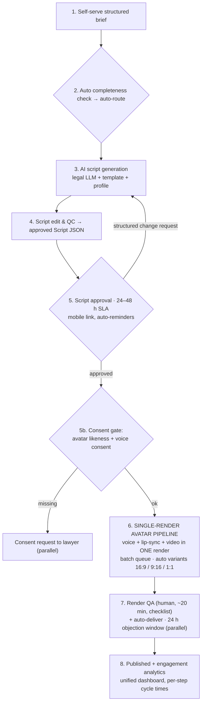

# Iteration 3 — Integrate audio and video generation

**Position in the chain:** the cliff. Iterations 1–2 standardized the front and turned the script into data; Iteration 3 deletes the manual bottom of the process. **One render produces voice, lip-sync, and video together** (single-render avatar generation), and the same render emits all platform variants — eliminating the separate audio track, the **2–3 h of manual synchronization [C]** that form the largest labour block, and the **~2 h of manual platform adaptation [C]**. This is where labour falls below one hour, cost falls ~75% in one step, and the constraint finally leaves HiLegal's building.

**Deliverable name for the demo:** *HiLegal Studio v3 — Render Pipeline*

---

## 1. Problem addressed (numbers as left by Iteration 2)

| Symptom after Iteration 2 | Evidence | Root cause (Section 4, chain 2) |
|---|---|---|
| Sync = 135 min = **~40% of all labour** — the binding constraint | Waterfall §1; company-reported largest block [C] | Video and audio generated as **separate artefacts**, married by hand |
| Platform adaptation still 75 min/video | Waterfall §1 | Manual resize/caption per platform |
| Generation ops (video 45 + audio 25 min) | Waterfall §1 | Two tool handoffs (Seedance prompt + TTS), two sets of retries |
| Cost still ¥595, capacity 33/mo vs. demand ambition 40+/mo | §3–4 | Labour-bound process |

**Prerequisite check (why this must come third):** the renderer consumes the **approved Script JSON** (scenes, voiceover text, on-screen text, durations) from Iteration 2. Rendering from documents or emails — the baseline state — is impossible; rendering from data is one API call.

## 2. Change introduced

1. **Single-render avatar pipeline**: `POST /v3/renders` takes the approved Script JSON + an avatar consent token → **one render** produces voice + lip-sync + video together (batch queue, ~20–30 min/video wall-clock, near-zero human attention). The separate TTS step and the manual sync step **cease to exist**.
2. **Auto platform variants from the same render**: 16:9 (site/YouTube) · 9:16 (Shorts/Reels/LinkedIn) · 1:1 (feed) — the 75–90 min of manual adaptation drops to zero and consistency between variants becomes structural.
3. **Avatar & consent registry** (from the proposal's risk register): written **likeness + voice consent per lawyer** before any avatar render (`POST /v3/avatars/{id}/consent`); consent status gates the render.
4. **Human QC stays — deliberately**: a 20-min render-QA pass per video (likeness, name pronunciation, captions, brand frames, per a digitized checklist). This is the quality guardrail the proposal commits to ("AI-generated content may require corrections — human quality control").
5. **Publish + objection window replaces the serial final approval**: the video auto-delivers to the lawyer's channels with a 24 h objection window that runs **in parallel** — the final gate stops adding serial waiting (this is what compresses lead time to 1–2 days).
6. **Engagement analytics** (to-be step 8): views/watch-time per platform flow back into the unified dashboard; per-step cycle-time logging continues — the PDCA habit, now covering the whole pipeline.

## 3. Updated process map (9 → 8 steps — the proposal's to-be shape)

**What fused vs. Iteration 2:** video generation + audio generation + manual sync + platform adaptation (4 steps, 280 min) collapse into one automated render + a 20-min QA pass. **What remains human:** brief exception handling, script edit/QC, render QA — by design.

## 4. API deltas vs. Iteration 2 (v3 surface — additive)

| Endpoint | Type | Purpose |
|---|---|---|
| `POST /v3/renders` | **new** | Script JSON + consent token → render job (single render: voice + lip-sync + video); returns `job_id` |
| `GET /v3/renders/{id}` + webhooks `render.completed` / `render.failed` | **new** | Batch queue status; failures auto-retry once, then alert |
| `GET /v3/renders/{id}/variants` | **new** | 16:9 / 9:16 / 1:1 outputs from the same job |
| `POST /v3/avatars` · `POST /v3/avatars/{id}/consent` | **new** | Avatar registry + **written likeness/voice consent** — consent gates rendering (compliance by construction) |
| `GET /v3/voices` | **new** | Brand voice library per language |
| `POST /v3/videos/{id}/publish` | **new** | Auto-deliver to lawyer channels + start 24 h objection window (replaces serial final approval) |
| `POST /v3/videos/{id}/engagement` | **new** | Views/watch-time ingestion → unified dashboard |
| `GET /v1/*`, `POST /v2/*` | unchanged | The chain: Brief JSON (v1) → Script JSON (v2) → Render (v3) — each layer consumes the previous one's output |

## 5. KPI effect

| KPI | Iter 2 | **Iter 3** | Δ vs. Iter 2 | Δ vs. baseline | Mechanism |
|---|---:|---:|---:|---:|---|
| Lead time | ~4 d | **~1.5 d (1–2) [T]** | −63% | **−93%** | Render ~30 min in batch; final approval parallelized (objection window); residual wait = lawyer's script approval only |
| Human time | 5 h 50 | **~1 h 00 (steady state) [T]** | −83% | **−90%** | Sync 135→0, adaptation 75→0, generation ops 70→0; remaining: brief exceptions 10 + params 5 + script edit 15 + render QA 20 + delivery 5 |
| Cost/video | ¥595 | **¥180 [T]** | −70% | **−81%** | 1 h labour (¥85) + render API ¥45 + LLM ¥20 + amortized pipeline ¥30 |
| Capacity | ~33/mo | **~190/mo [T]** | ~6× | **~10×** | 60 min/video at same staffing — matches the proposal's "tenfold capacity increase with the existing team" |
| Rework rate | ~30% | **~10% [T]** | −20 pts | −89% | Single render from the approved script: no transcription/sync defects; variants structurally consistent; residual = avatar glitches, name pronunciation |
| QAR | ~70% | **~90% [T]** | +20 pts | +80 pts | Same mechanism |

## 6. KPI-check methodology (pilot gate)

**Pilot design:** 10 videos through v3; compare against the v2 cohort. Add a technical-QC log (render retries, QA checklist failures by category).
**Pass criteria:**

| Check | Threshold | Fails if |
|---|---|---|
| Median lead time | ≤ 2 business days | > 2 d → investigate approval SLA compliance (the only serial wait left) |
| Human time | ≤ 1 h 30 avg during pilot; ≤ 1 h 05 at steady state (video 10+) | persistently > 1 h 30 → QA checklist bloated or renders failing often |
| Render success rate | ≥ 90% first-pass, ≥ 98% after one auto-retry | < 90% → vendor/model issue; switch to dual-vendor fallback (proposal mitigation) |
| Variant completeness | 3/3 variants on 100% of videos | manual re-exports creeping back |
| Rework rate | ≤ 12% | > 12% → QA checklist misses a recurring defect class; add it to the auto-check |
| **Guardrails:** consent on file = **100%** of avatar renders (hard gate, zero tolerance) · compliance incidents = 0 · client satisfaction ≥ v2 cohort | | any consent gap = stop-the-line incident |

**Steady-state transition rule:** after 50 videos, re-baseline human time; if ≤ 1 h 05, declare the proposal's "under one hour" target met operationally and lock the standard.

## 7. Remaining limitation (the honest close of Section 6)

- **The constraint is now the lawyer's own approval time.** Residual lead time ≈ 100% client-side (24–48 h script approval). Further improvement requires managing the client (SLAs in subscription terms, reminders, escalation) — not more internal automation. Iteration 1's SLA machinery is already in place; the process is as fast as its slowest client.
- **AI-vendor dependency** (proposal risk): render + LLM pricing and lock-in → dual-vendor evaluation and interchangeable components; the Script JSON layer keeps the pipeline renderer-agnostic.
- Volume ceiling is now demand, not capacity: at 40 videos/month the two producers spend **~4 h/month** total on video (see `kpi-data.md` §4) — the staffing question inverts from "can we hire enough producers?" to "what should the company do with the payroll and the management attention that no longer go into video?" → Section 8's answer: fund the legal LLM.

## 8. Risks & guardrails

| Risk | Mitigation |
|---|---|
| Avatar renders uncanny / mispronounce names | QA checklist item; name-pronunciation test render; retry; vendor SLA |
| Likeness/voice consent (proposal risk — legal exposure) | Consent token **hard-gates** every render; registry with expiry; zero-tolerance pilot rule |
| Vendor pricing/lock-in (proposal risk) | Dual-vendor evaluation; renderer-agnostic Script JSON contract; monthly cost-per-render tracking |
| Quality dilution at scale ("faster but worse") | QAR + satisfaction guardrail at every pilot gate; human QC steps never removed |
| Lawyers want bespoke (non-template) videos | Escalation path: bespoke requests priced separately — the standardized line serves the subscription tier |
